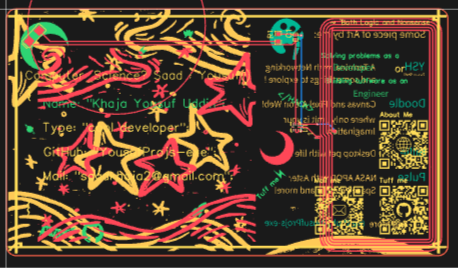
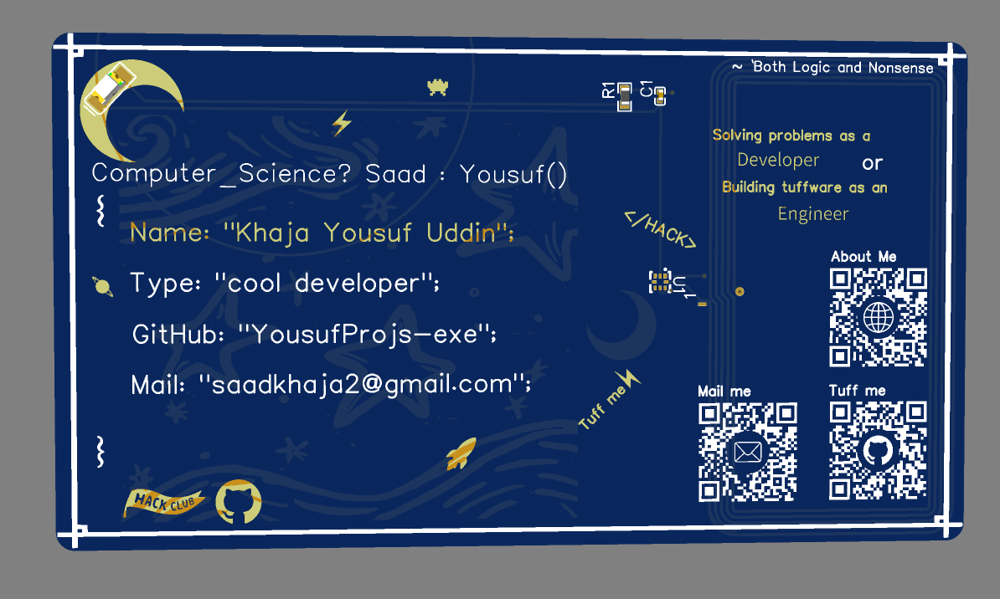
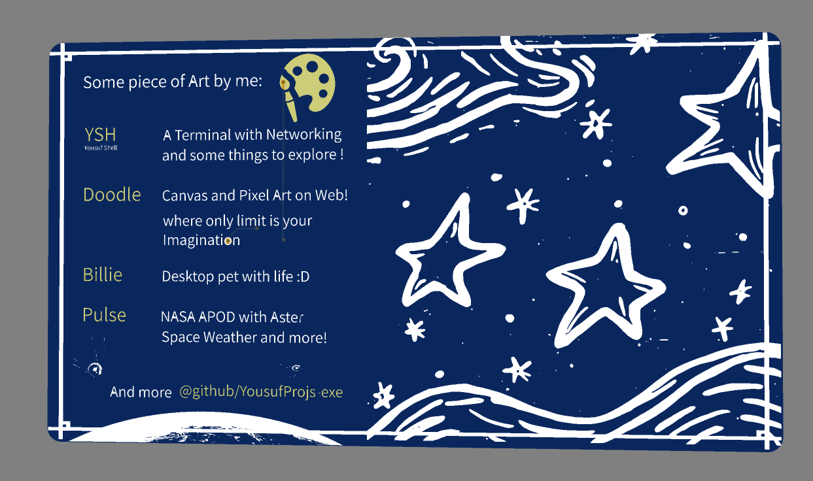
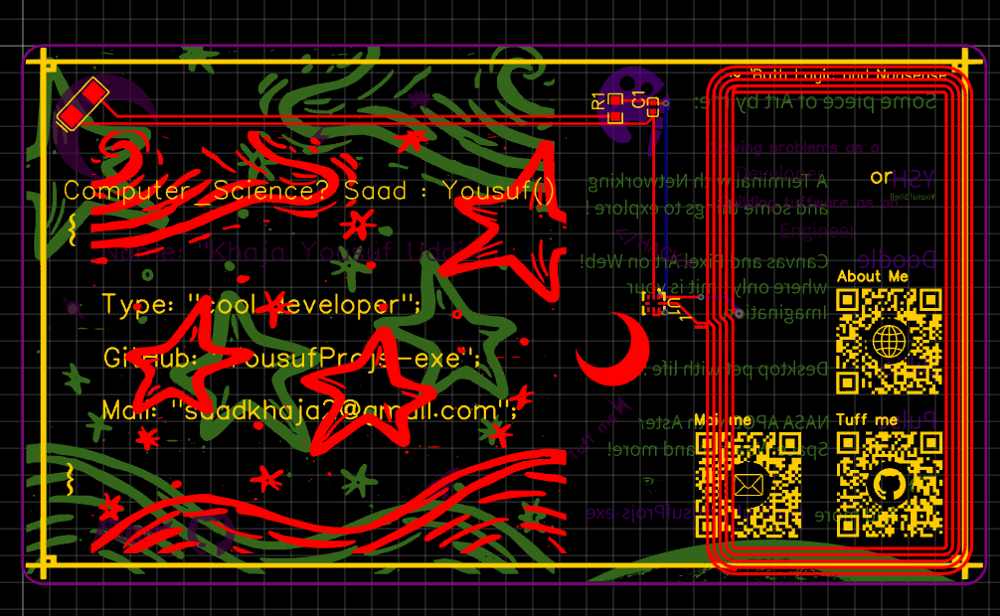
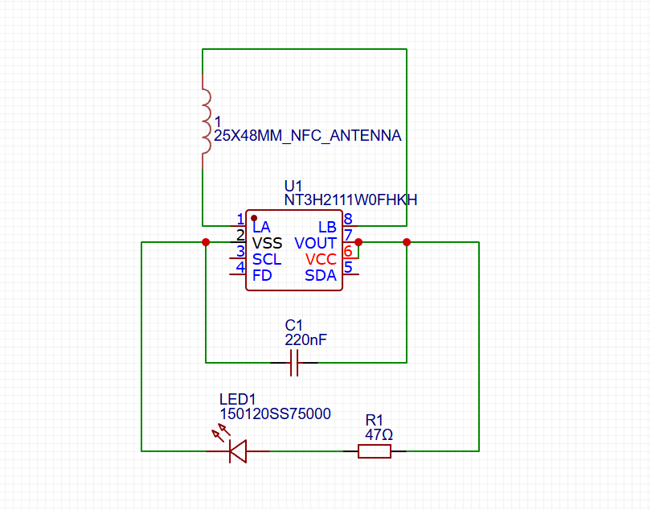

# BITSHIFT

**BITSHIFT** is a custom NFC business card that I am designing from scratch.

The idea is simple: instead of handing someone a traditional business card, they can tap their phone against mine and open my portfolio. The card combines NFC functionality with a custom-designed PCB, making it both a practical contact card and a small hardware project.

I started this project using the [Hack Club Hacker Card guide](https://jams.hackclub.com/jam/hacker-card) as a reference. I wanted to take the idea further by designing my own schematic, PCB layout, antenna, and overall board artwork using EasyEDA.

This is also my way of getting more hands-on experience with electronics and PCB design rather than just working on software projects.

## Features

- **NFC functionality** – Allows a compatible phone to read the card and open my portfolio.
- **Custom PCB** – Designed from scratch in EasyEDA Standard.
- **Custom NFC antenna** – Designed as part of the PCB layout.
- **Energy-harvesting LED** – Uses energy from the NFC field to power an LED.
- **QR code** – Provides another way to access my portfolio.
- **Custom artwork** – The PCB itself is designed to look like a business card.

## Design Preview

These are the current design previews from EasyEDA and the Gerber files.

### Gerber Preview

### Front Design

### Back Design

### PCB Layout

### Schematic

## How It Works

BITSHIFT uses NFC to make sharing my portfolio easier.

When a compatible phone is brought close to the card, the NFC reader in the phone powers and communicates with the NFC chip. The chip provides the stored information, allowing the phone to open the portfolio link.

The card also includes a QR code as an alternative way to access the same destination.

The LED is designed to use energy from the NFC field, so it does not need a separate battery.

## Hardware Design

The schematic and PCB layout were created using **EasyEDA Standard**.

The design includes the NFC chip, its supporting components, a custom antenna, and the LED circuit. I worked on the schematic first and then moved on to the PCB layout.

The antenna is an important part of the design because NFC communication depends on the antenna and its connection to the NFC chip. The PCB layout therefore needs to be reviewed carefully before manufacturing.

### Design Files

| File | Description |
|---|---|
| `SCH_BITSHIFT_2026-11-03.json` | Original EasyEDA schematic |
| `PCB_PCB_BITSHIFT_2026-11-03.json` | Original EasyEDA PCB design |
| `Sheet_1_2026-11-03.svg` | Schematic SVG export |
| `PCB_BITSHIFT_2026-11-03.svg` | PCB layout SVG export |
| `BOM_BITSHIFT_2026-11-03 (1).csv` | Bill of Materials |

## Gerber Files

The Gerber files are exported from EasyEDA and included in the repository.

They contain the manufacturing information for the PCB, including the copper layers, solder mask, silkscreen, board outline, and drill data.

The files are available in:

[`Gerber_BITSHIFT/`](./Gerber_BITSHIFT/)

These files are intended for PCB manufacturing. The design still needs to be checked and tested with a manufactured board.

## Bill of Materials (BOM)

| ID | Component | Designator | Footprint | Qty | Manufacturer | Manufacturer Part Number | Supplier |
|---:|---|---|---|---:|---|---|---|
| 1 | NFC Antenna (25 × 48 mm) | 1 | 25X48MM_NFC_ANTENNA | 1 | — | — | — |
| 2 | 220nF Capacitor | C1 | C0402 | 1 | TDK | C1005X5R0J224KT000F | LCSC |
| 3 | Red LED | LED1 | LED1206-RD_1 | 1 | Würth | 150120SS75000 | LCSC |
| 4 | 47Ω Resistor | R1 | R0603 | 1 | UNI-ROYAL | 0603WAF470JT5E | LCSC |
| 5 | NFC Chip | U1 | XQFN-8 | 1 | NXP | NT3H2111W0FHKH | LCSC |

**Total component entries:** 5

The BOM contains the component names, footprints, quantities, manufacturer part numbers, and supplier information exported from EasyEDA.

[View Original BOM CSV](./BOM_BITSHIFT_2026-11-03%20(1).csv)

## Tools Used

- **EasyEDA Standard** – Schematic capture and PCB design.
- **Hack Club Jams – Hacker Card** – Initial project reference.
- **GitHub** – Source files, design exports, and project documentation.

## Project Links

- GitHub Repository: https://github.com/YousufProjs-exe/BITSHIFT
- Hack Club Forge: https://forge.hackclub.com/projects/4396
- Hacker Card Reference: https://jams.hackclub.com/jam/hacker-card

* BITSHIFT is a personal hardware project. The current repository contains the design files and manufacturing exports; the physical PCB has not yet been manufactured and tested.

I kept the BOM as a link rather than inventing supplier prices or quantities that I can't verify.
