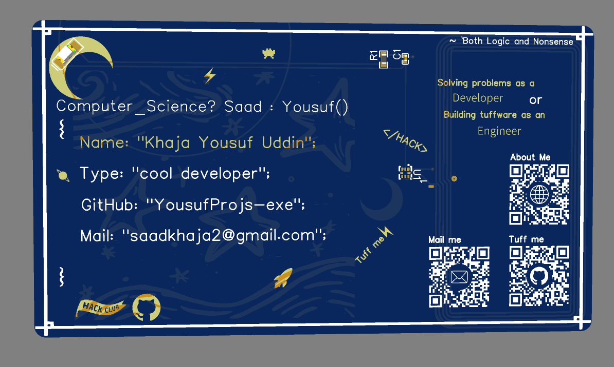
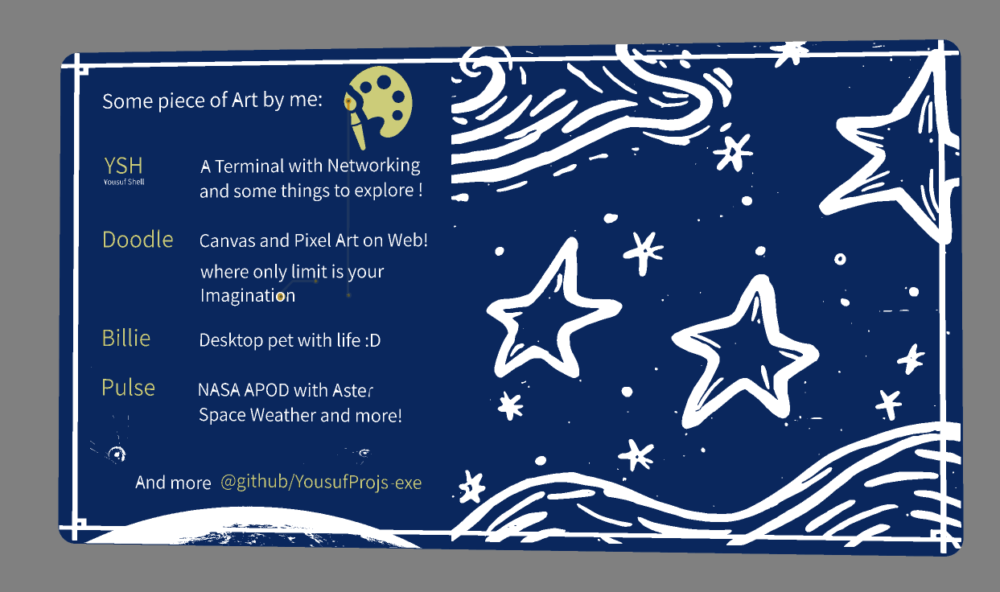
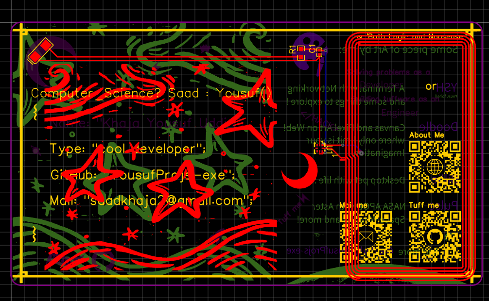
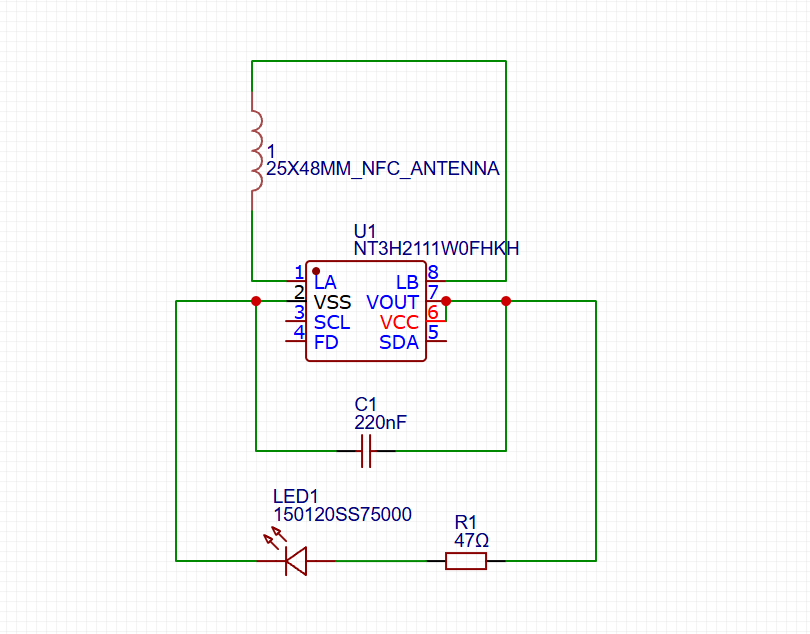

# BITSHIFT

BITSHIFT is my attempt at making my own NFC business card.
The idea is simple: tap the card with a phone and open my portfolio. I'm designing the PCB myself, using an NFC chip and a custom antenna.
I'm making the card from scratch in EasyEDA, so this project is also a way for me to learn more about PCB design and NFC.

## Project Files

- SCH_BITSHIFT_2026-11-03.json [SCH](./SCH_BITSHIFT_2026-11-03.json) — Schematic
- PCB_PCB_BITSHIFT_2026-11-03.json [PCB](./PCB_PCB_BITSHIFT_2026-11-03.json) — PCB design

## Build using 

- EasyEDA Standard Online 
- Jams/Hacker-Card for initial start and reference
- 

## Status

The initial schematic and PCB design are ready. The next step is to review the design, get the PCB made, and test it.

## Links

- [Forge Project](https://forge.hackclub.com/projects/4396)

## BOM 
[BMO](./BOM_BITSHIFT_2026-11-03%20(1).csv)
